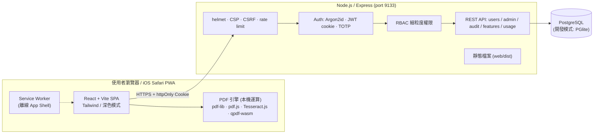
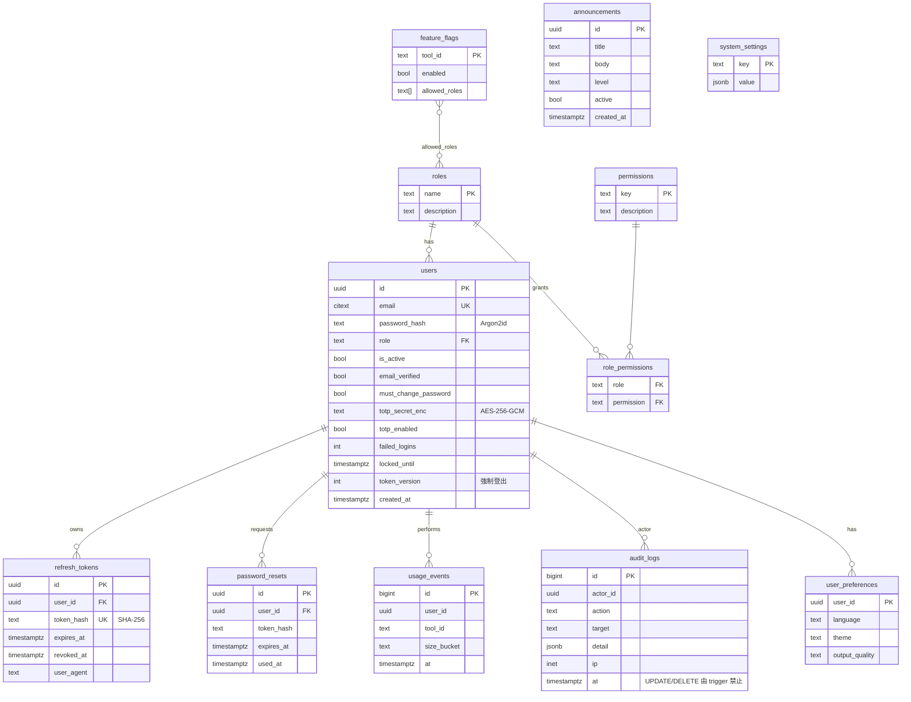

# PDF 工具箱 — 系統架構與資料庫 ERD

## 1. 系統架構



### 設計原則
| 原則 | 實作 |
|---|---|
| 檔案預設不離開裝置 | 合併、分割、壓縮、浮水印、OCR、加密、塗黑…全部在瀏覽器完成 |
| 伺服器只存「元資料」 | 帳號、設定、稽核日誌、用量統計（僅工具名稱/大小區間），**不存檔案內容** |
| 授權永遠在伺服器 | 所有 `/api/*` 以 middleware 檢查 session + 權限，前端僅負責顯示 |

### 模組劃分
```
web/    React SPA（tools/ 工具引擎、pages/、components/、lib/）
server/ Express API（auth、rbac、admin、db、security）
docs/   架構、ERD、已知限制
```

## 2. 資料庫 ERD



### 關鍵約束
- `audit_logs`：資料庫 trigger 拒絕 `UPDATE` / `DELETE` / `TRUNCATE`（任何角色皆不可刪除，只能由 DBA 以備份策略管理）。
- `users.totp_secret_enc`：AES-256-GCM（`APP_ENC_KEY` 由環境變數/KMS 提供）。
- `refresh_tokens`：只存雜湊；旋轉（rotation）＋可撤銷；偵測重放時撤銷整個 token family（使用者全部 refresh）。
- `token_version`：管理者「強制登出」時遞增，使既有 access token 立即失效。

## 3. 認證流程
1. 登入：Argon2id 驗證 → （若啟用 TOTP）要求 6 位數 → 設定 `access`（15 分鐘）與 `refresh`（7 天）httpOnly+Secure+SameSite=Strict Cookie，另發 `csrf` Cookie（雙重提交）。
2. 呼叫 API：`X-CSRF-Token` 必須等於 `csrf` Cookie；access 過期時前端呼叫 `/api/auth/refresh`（旋轉）。
3. 連續 5 次失敗鎖定 15 分鐘；每 IP 速率限制。
4. 管理者首次登入：`must_change_password` 與強制 TOTP 設定，未完成前僅能存取 `/api/auth/*`。

## 4. 實作順序
基礎框架 → 認證與 RBAC → PDF 核心工具 → 進階工具 → 管理後台 → 資安加固 → PWA 與 iOS 驗證。
